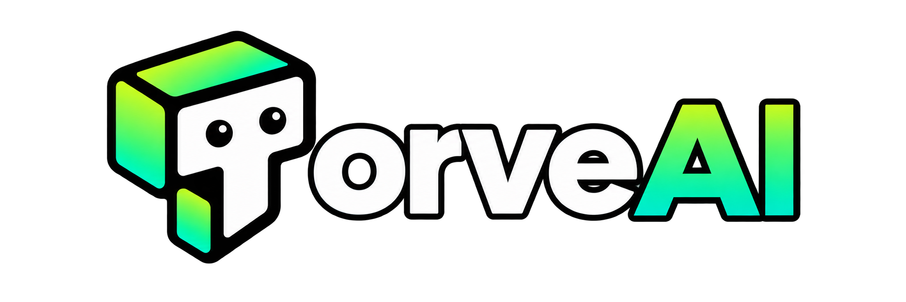
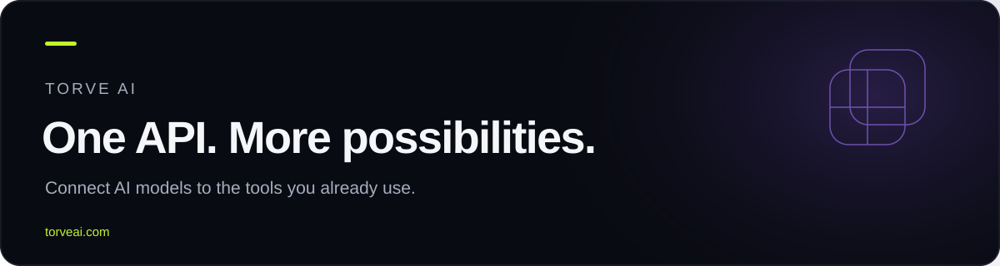

  

  <a href="https://torveai.com">Website</a> &nbsp; · &nbsp;
  <a href="https://torveai.com/docs/quickstart">Documentation</a> &nbsp; · &nbsp;
  <a href="https://torveai.com/status">System status</a> &nbsp; · &nbsp;
  <a href="https://t.me/torveaiofficial">Community</a>

### Build with AI, your way.

Torve AI connects multiple AI models through a single API key. Use our OpenAI-compatible and Anthropic-compatible endpoints in your applications, explore models in the Playground, or connect directly to Claude Desktop.

| Explore | Get started |
| :--- | :--- |
| **AI API** — integrate models through familiar API formats. | [Read the quickstart](https://torveai.com/docs/quickstart) |
| **Playground** — chat, search the web, and work with files. | [Open your workspace](https://torveai.com/dashboard) |
| **Claude Desktop** — connect Torve AI using the documented setup. | [Follow the setup guide](https://torveai.com/docs/claude-desktop) |
| **Model catalog** — see published models and availability. | [Explore models](https://torveai.com/all-api-models) |

### Stay connected

Check [system status](https://torveai.com/status) for service health, join our [Telegram community](https://t.me/torveaiofficial) for updates, or contact support from your [dashboard](https://torveai.com/dashboard/support).

---

Building practical access to AI. Learn more at [torveai.com](https://torveai.com).
